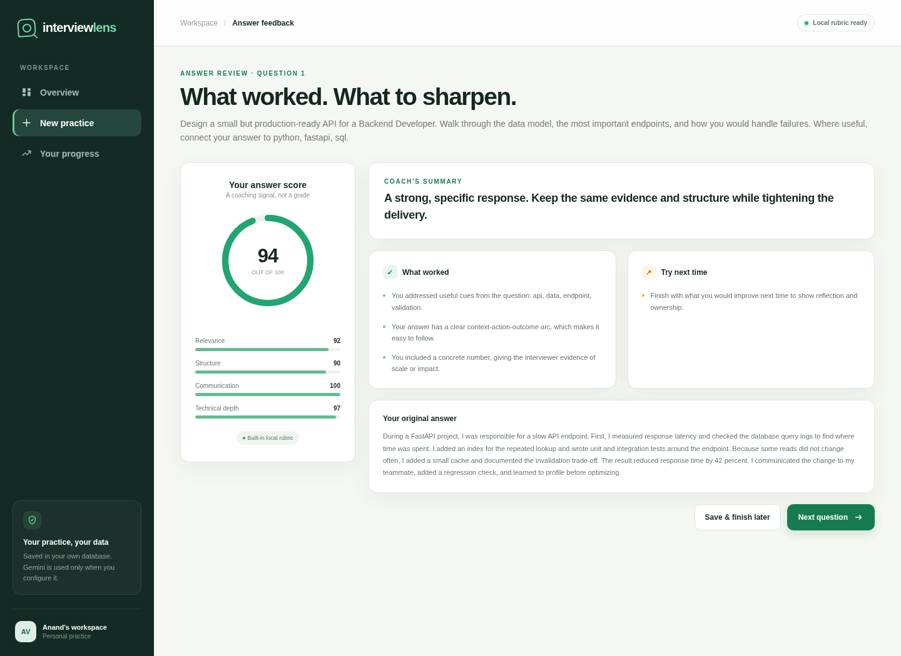

# InterviewLens

A full-stack interview practice app that turns written answers into specific, actionable coaching. Create a role-focused practice run, answer technical and behavioral questions, and track your progress across four communication and engineering signals.

InterviewLens works out of the box with a transparent local scoring rubric. You can optionally configure Gemini for AI-enhanced feedback; the interface always shows which engine reviewed an answer.



## Features

- **Role-focused practice** with 3–8 mixed, technical, or behavioral questions
- **Job-description signals** that make the opening question more relevant to the target role
- **Four scoring dimensions**: relevance, structure, communication, and technical depth
- **Specific feedback** with strengths, improvements, and the original answer kept for review
- **Progress dashboard** with session history, completion status, and skill averages
- **Local-first storage** in SQLite, with no account or API key required
- **Optional Gemini feedback** using a server-side key that is never sent to the browser
- **Responsive interface** built with accessible, dependency-free HTML, CSS, and JavaScript

## Tech stack

- Python 3.10+
- FastAPI and Pydantic
- SQLAlchemy 2 and SQLite
- Vanilla JavaScript, HTML, and CSS
- Pytest and Playwright for testing
- Optional Google Gemini API

## Quick start

```bash
git clone <your-repository-url>
cd interviewlens
python -m venv .venv
source .venv/bin/activate        # Windows: .venv\Scripts\activate
pip install -r requirements.txt
uvicorn app.main:app --reload
```

Open [http://127.0.0.1:8000](http://127.0.0.1:8000). The SQLite database is created automatically on first run.

### Optional Gemini setup

```bash
cp .env.example .env
```

Add your key and preferred model to `.env`:

```dotenv
GEMINI_API_KEY=your_key_here
GEMINI_MODEL=gemini-2.5-flash
```

Restart the server after changing `.env`. If Gemini is not configured or a request fails, the app uses the local rubric and labels the result accordingly. When Gemini is configured, the target role, question, and answer are sent to Google's Gemini API for review.

## Run the tests

```bash
pip install -r requirements-dev.txt
pytest -q
```

The tests cover session creation, question ordering, answer validation and persistence, duplicate-answer protection, progress aggregation, session completion, and local scoring.

### Browser smoke test

With the app running on port 8000 and a Chrome installation available:

```bash
python tests/e2e.py
```

The smoke test creates a practice session, submits an answer, checks the feedback flow, verifies navigation to the next question, and captures desktop and mobile screenshots in `artifacts/`. It uses an installed Chrome/Chromium when available; otherwise run `playwright install chromium` first.

## API overview

| Method | Endpoint | Purpose |
| --- | --- | --- |
| `GET` | `/api/health` | App status and whether Gemini is configured |
| `POST` | `/api/sessions` | Create a practice session and its questions |
| `GET` | `/api/sessions/{id}` | Read a session, questions, and saved feedback |
| `POST` | `/api/questions/{id}/answer` | Analyze and save one answer |
| `GET` | `/api/dashboard` | Aggregate progress and recent sessions |

Interactive API documentation is available at `/docs` while the server is running.

## How local scoring works

The built-in rubric is deterministic and inspectable in `app/services/analyzer.py`. It checks question cues, answer structure, length and filler words, engineering vocabulary, reasoning terms, and concrete measurements. It is a practice aid, not a hiring prediction or a substitute for human feedback.

## Project structure

```text
app/
├── main.py                 # API routes and serialization
├── models.py               # SQLAlchemy persistence models
├── schemas.py              # Request and response validation
├── question_bank.py        # Original prompts and role signals
├── services/
│   ├── analyzer.py         # Transparent local feedback rubric
│   └── gemini.py           # Optional Gemini integration
└── static/                 # Responsive browser interface
tests/
├── test_api.py             # API and persistence tests
├── test_analyzer.py        # Scoring tests
└── e2e.py                  # Browser smoke test
```

## Privacy and configuration

- Practice data is stored in the configured SQL database.
- `.env`, database files, virtual environments, and test artifacts are ignored by Git.
- Gemini is opt-in and uses a server-side API key.
- Use a production-grade database, HTTPS, authentication, rate limiting, and managed secrets before deploying this as a multi-user service.

## License

MIT
